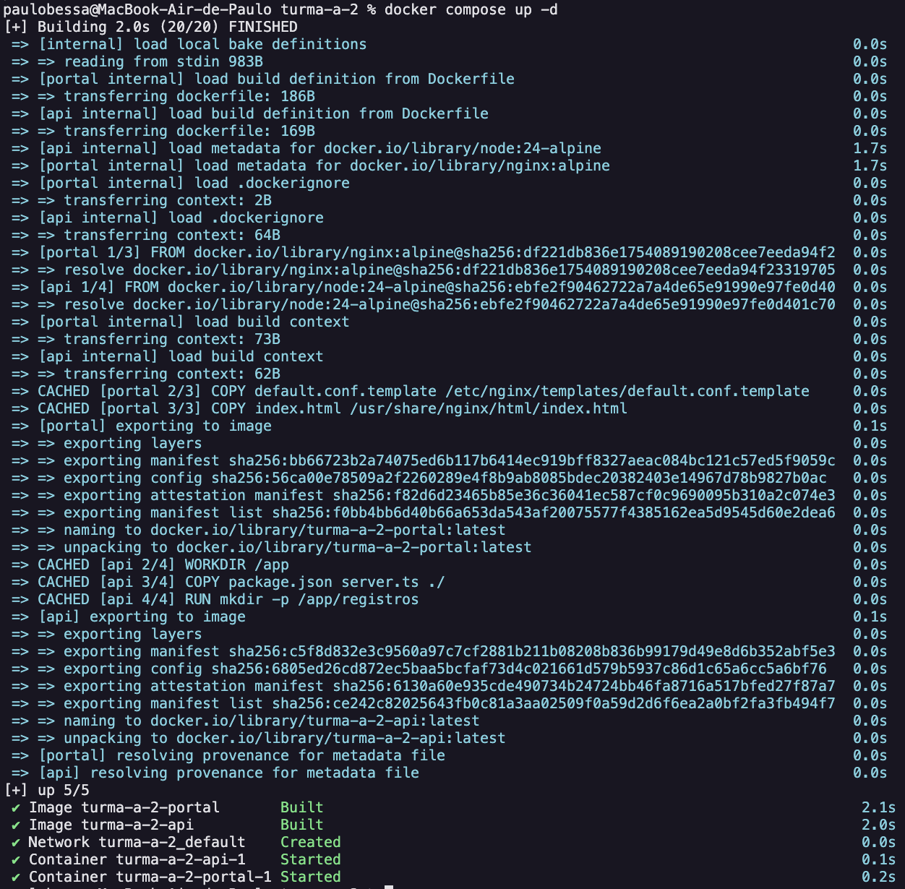
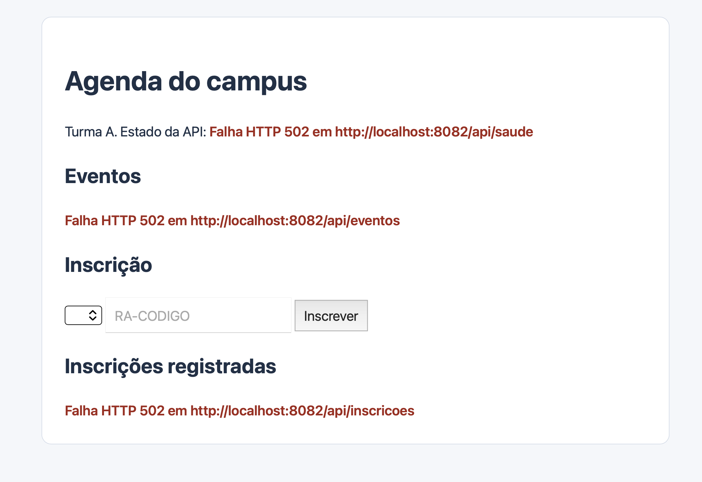
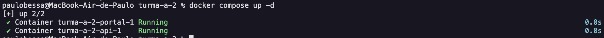
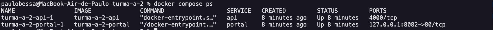
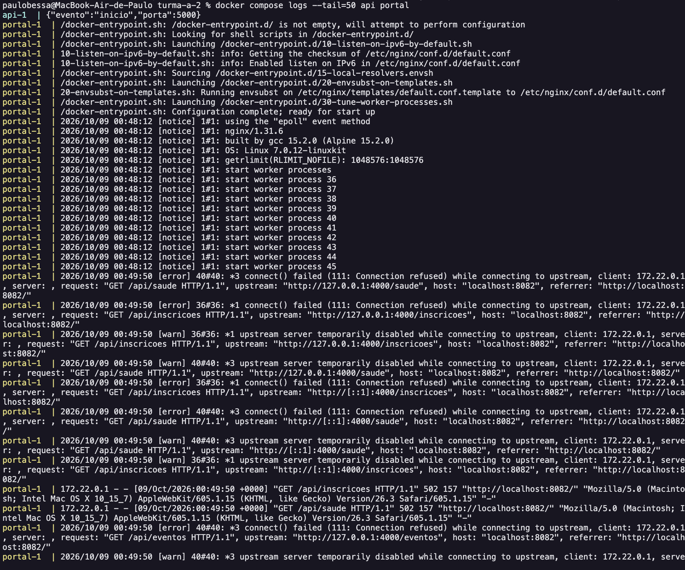
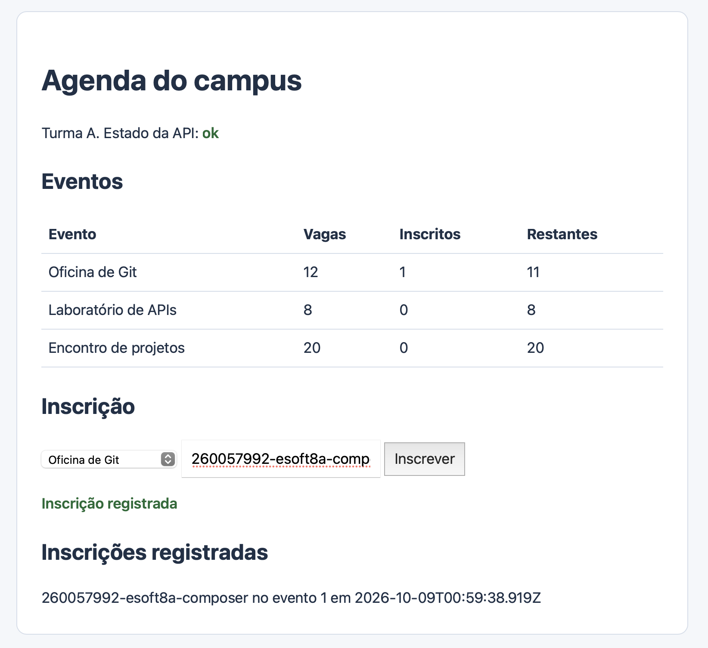

# Evidencias

## Primeiro comando

docker compose up -d

## Erro na API

## Correções

### Backend
- Variável de ambiente alterada -> PORT: "4000"

### Frontend
- Adicionando propriedade hostname:"localhost"
- Variável de ambiente alterada -> API_URL: "http://api:4000"

## Comandos depois das correções

